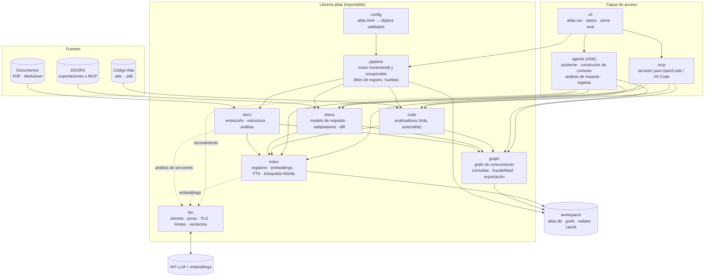
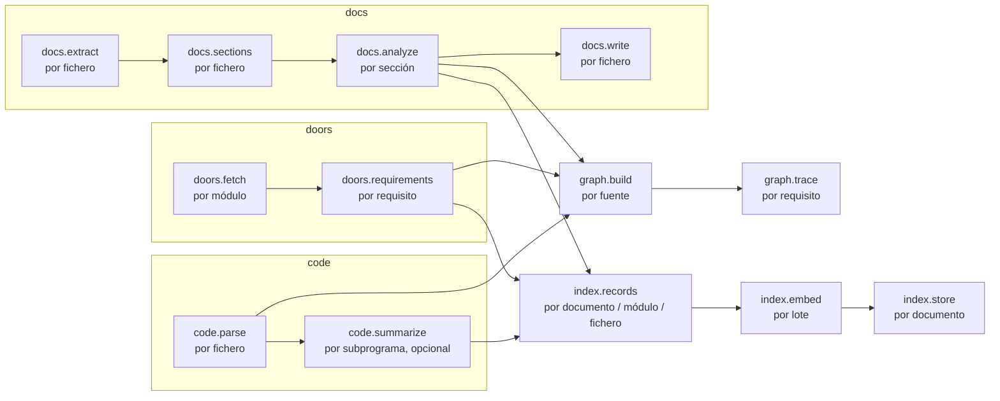
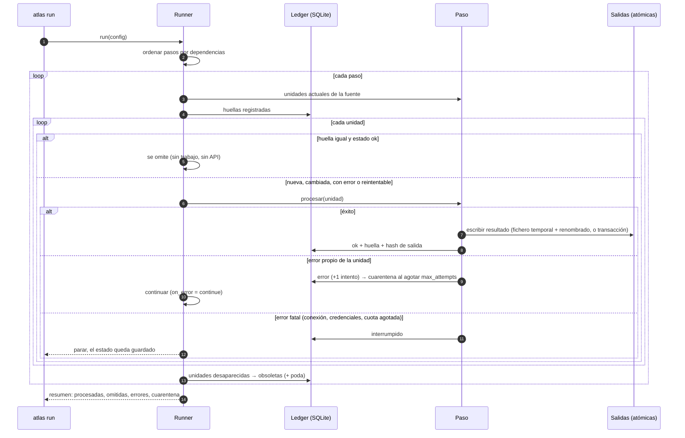
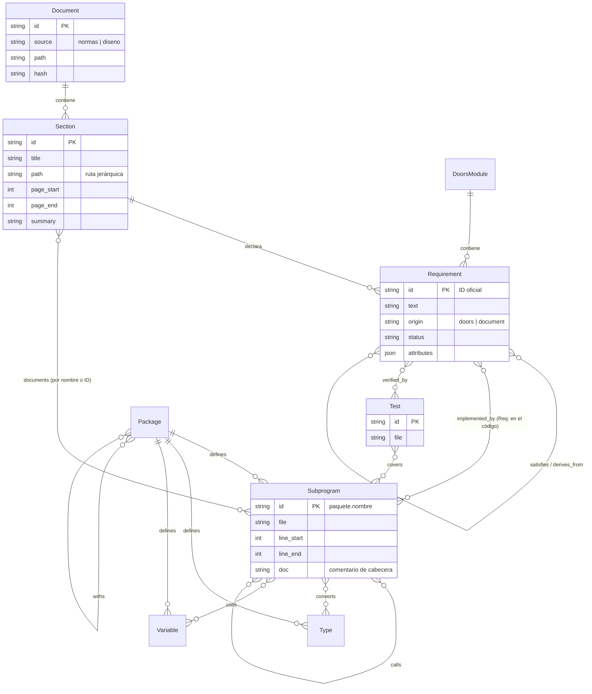
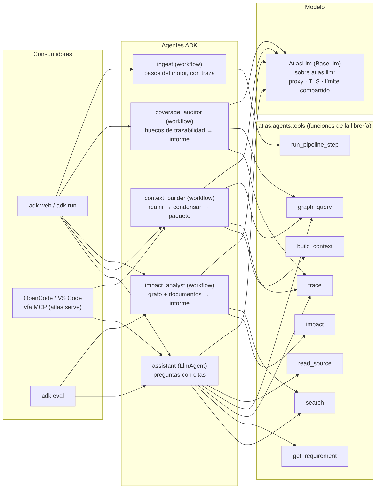
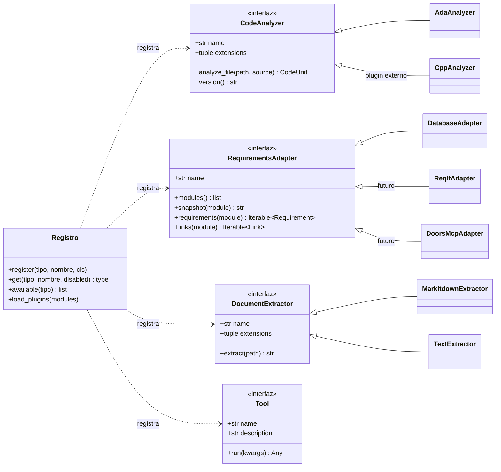

# Plan de proyecto — `atlas`: base de conocimiento de ingeniería (documentos, requisitos, código y grafo) orquestada con Google ADK

> `atlas` es un nombre provisional. Todo lo que sigue parte del código ya existente
> (`conexion.py`, `pdf_struct.py`, `doc_rag.py`, `ada_graph.py`, `ada_graph_mcp.py` y el
> servidor MCP de DOORS) y lo reorganiza como una librería Python configurable por fichero.

## Contenido

1. [Objetivo y alcance](#1-objetivo-y-alcance)
2. [Principios de diseño](#2-principios-de-diseño)
3. [Arquitectura](#3-arquitectura)
4. [Estructura del paquete y API pública](#4-estructura-del-paquete-y-api-pública)
5. [Configuración](#5-configuración)
6. [Motor de procesamiento incremental y recuperable](#6-motor-de-procesamiento-incremental-y-recuperable)
7. [Modelo de datos y grafo de conocimiento](#7-modelo-de-datos-y-grafo-de-conocimiento)
8. [Orquestación con Google ADK](#8-orquestación-con-google-adk)
9. [Fases, entregables y criterios de aceptación](#9-fases-entregables-y-criterios-de-aceptación)
10. [Calendario](#10-calendario)
11. [Pruebas y evaluación](#11-pruebas-y-evaluación)
12. [Riesgos y mitigaciones](#12-riesgos-y-mitigaciones)
13. [Supuestos y preguntas abiertas](#13-supuestos-y-preguntas-abiertas)
14. [Extensibilidad: plugins](#14-extensibilidad-plugins)
15. [DOORS desde una base de datos](#15-doors-desde-una-base-de-datos)
16. [Entorno de desarrollo y esqueleto entregado](#16-entorno-de-desarrollo-y-esqueleto-entregado)

---

## 1. Objetivo y alcance

### Problema

Programar con un modelo pequeño y lento sobre un sistema con miles de requisitos (normas,
especificaciones en DOORS) y una base de código Ada grande obliga a reunir contexto a mano
o a encadenar muchas llamadas a herramientas, cada una lenta. Además, procesar esa
documentación cuesta horas de API: no puede repetirse cada vez ni perderse por un error.

### Objetivo

Una librería Python, `atlas`, que construye y mantiene una **base de conocimiento unificada**
a partir de cuatro fuentes y la pone al servicio de agentes (ADK) y de herramientas de
programación (OpenCode, VS Code) a través de MCP:

| Fuente | Qué aporta | Punto de partida |
|---|---|---|
| Documentos (PDF, Markdown) | normas y documentos de diseño estructurados, requisitos, glosario | `pdf_struct.py`, `doc_rag.py` |
| DOORS | requisitos oficiales con atributos y enlaces entre módulos | servidor MCP de DOORS existente |
| Código (Ada) | paquetes, subprogramas, tipos, variables, llamadas, comentarios `Req:` | `ada_graph.py` |
| Grafo | la relación entre todo lo anterior: trazabilidad, impacto, dependencias | `ada_graph_mcp.py` |

### Metas medibles

1. **Procesar una vez**: una segunda ejecución sin cambios no hace ninguna petición a la API
   y termina en menos de un minuto para un proyecto de 2000 secciones + 5000 requisitos +
   3000 subprogramas.
2. **Solo los cambios**: modificar un fichero (PDF, módulo DOORS o `.adb`) reprocesa solo
   sus unidades y lo que depende de ellas; el resto sale de caché.
3. **Recuperable**: tras un corte (error de red, cuota agotada, Ctrl+C, `kill`), relanzar
   continúa donde se quedó sin repetir ningún resultado válido ni dejar datos corruptos.
4. **Configurable por fichero**: toda la ejecución se define en `atlas.toml`; la línea de
   comandos solo indica qué fichero usar y qué acción lanzar.
5. **Importable**: cada módulo tiene una API pública documentada y se puede usar sin ADK,
   sin MCP y sin el resto de módulos (`from atlas.code import AdaAnalyzer`).
6. **Trazabilidad**: para cualquier ID de requisito se obtiene en una sola llamada su texto
   oficial, el documento donde aparece, el código que lo implementa y las pruebas que lo
   cubren, y a la inversa.
7. **Evaluable**: un conjunto de preguntas y tareas con respuesta conocida mide la
   recuperación y las respuestas de los agentes en cada versión.

### Fuera de alcance (no-objetivos)

- Escribir en DOORS: el acceso es de solo lectura.
- Sustituir al editor o al agente de programación (OpenCode, VS Code): `atlas` les
  suministra conocimiento, no edita código.
- Ajuste fino de modelos: el modelo se usa tal cual, a través de la API.
- Despliegue en la nube: todo corre en el puesto de trabajo o en un servidor interno, por
  confidencialidad.
- Otros lenguajes aparte de Ada en la primera versión; la interfaz queda preparada.

---

## 2. Principios de diseño

1. **Determinista primero, modelo después.** Extracción, estructura, grafo, trazabilidad y
   búsqueda se hacen sin LLM. El modelo entra solo donde aporta: resúmenes, respuestas,
   razonamiento de los agentes. Es la forma de que un modelo pequeño y con cupo sea útil.
2. **Librería, no aplicación.** Toda la lógica vive en `atlas.*` con funciones y clases
   puras; la línea de comandos, los agentes ADK y el servidor MCP son capas finas.
3. **Todo es una unidad con huella.** Cada fichero, sección, requisito y subprograma es una
   unidad con una huella (hash de su contenido, de la configuración que le afecta y de la
   versión del código que lo procesa). El motor solo reprocesa unidades cuya huella cambia.
4. **Escrituras atómicas y estado explícito.** Cada paso escribe sus resultados de forma
   atómica y anota su estado en un libro de registro. Un corte nunca deja mitades.
5. **Una configuración, muchas entradas.** Un único `atlas.toml` validado contra un esquema;
   los secretos se leen de variables de entorno (`${VAR}`).
6. **Pocas herramientas, bien descritas.** Los agentes disponen de 5-8 herramientas con
   salidas compactas; los flujos de varios pasos son fijos (workflow), no improvisados por
   el modelo.
7. **Reutilizar lo que ya funciona.** El código actual se migra módulo a módulo manteniendo
   su comportamiento y sus pruebas; no se reescribe desde cero.
8. **Todo lo variable es un plugin.** Analizadores de código, fuentes de requisitos,
   extractores de documentos y herramientas de agente se registran por nombre y se activan
   o desactivan desde la configuración, sin tocar el núcleo (sección 14).

---

## 3. Arquitectura



**Decisiones clave y sus alternativas:**

| Decisión | Por qué | Alternativa descartada |
|---|---|---|
| Motor incremental propio sobre SQLite | control total de huellas, reanudación y poda; sin dependencias pesadas | Prefect/Dagster/Snakemake: potentes, pero añaden servidores o convenciones que no encajan con una librería embebible |
| SQLite como único almacén (registro, índice, grafo) | un fichero, transacciones, sin servicios; ya probado en `doc_rag.py` | Qdrant/Neo4j: mejores a gran escala, pero infraestructura y permisos que no hacen falta para este volumen |
| Grafo en SQLite + NetworkX en memoria | consultas rápidas, exportable a GraphML/JSON, sin servidor | base de datos de grafos dedicada |
| ADK orquesta flujos y agentes; el motor de ingesta es determinista | ADK aporta flujos, herramientas, trazas y evaluación; el ETL no necesita un LLM que lo dirija | orquestar el ETL con agentes LLM: lento, caro y menos fiable |
| MCP como interfaz hacia editores | OpenCode y VS Code ya lo hablan; un solo servidor para todo | un plugin por editor |
| TOML con `${VAR}` para secretos | ya se usa en `conexion.toml`; comentable; tipado | YAML (más ambiguo), JSON (sin comentarios) |

---

## 4. Estructura del paquete y API pública

```
atlas/
├── __init__.py            versión, carga rápida (atlas.load("atlas.toml"))
├── config/                esquema del TOML (dataclasses), validación, expansión ${VAR}, huellas
├── llm/                   connection.py (el conexion.py actual, en inglés): clientes OpenAI, proxy, TLS, límites, reintentos
├── pipeline/              motor incremental: Step, Unit, Ledger, Runner, poda, estado
├── docs/                  pdf_struct.py actual: extracción, estructura, análisis, Markdown
├── doors/                 modelo Requirement/Link, adaptadores (ReqIF, CSV, MCP), diff por ID
├── code/                  LanguageAnalyzer (interfaz) + AdaAnalyzer (tree-sitter)
├── graph/                 esquema de nodos/aristas, cargadores, consultas, trazabilidad, exportación
├── index/                 registros, embeddings con caché, FTS5, búsqueda híbrida, contexto
├── agents/                ADK: herramientas, agentes LLM, flujos, conjuntos de evaluación
├── mcp/                   servidor MCP que expone las mismas herramientas que agents/
└── cli.py                 atlas run | status | serve | eval  CONFIG
```

Reglas para que cada módulo sea importable por separado:

- Sin efectos secundarios al importar (nada de leer ficheros ni abrir conexiones en
  `import`).
- Cada módulo recibe su configuración como objeto (`DocsConfig`, `CodeConfig`...), nunca
  lee `argparse` ni variables globales. `atlas.config` construye esos objetos desde el TOML,
  pero también se pueden crear a mano en Python.
- Dependencias opcionales por módulo (`pip install atlas[docs]`, `[code]`, `[agents]`):
  importar `atlas.graph` no exige tree-sitter ni ADK.
- Registro con `logging` (nunca `print`), un logger por módulo.
- API pública en `__all__` y documentada; lo interno con guion bajo.

Ejemplos de uso como librería:

```python
from atlas.config import load_config
from atlas.code import AdaAnalyzer
from atlas.graph import KnowledgeGraph
from atlas.index import Index
from atlas.pipeline import Runner

cfg = load_config("atlas.toml")

# Solo el analizador de código, sin nada más
units = AdaAnalyzer(cfg.sources.code).analyze_file("src/tracks.adb")

# Solo el grafo ya construido
g = KnowledgeGraph.open(cfg.storage)
print(g.impact("delete_message", depth=3))
print(g.trace("DELETE-X_2-MSG"))          # requisito → código, pruebas, documentos

# Solo la búsqueda
hits = Index.open(cfg.storage, cfg.embeddings).search("latencia de borrado de traza", k=8)

# Todo el procesamiento, incremental y reanudable
Runner(cfg).run()                          # equivale a: atlas run atlas.toml
```

---

## 5. Configuración

Un único fichero `atlas.toml`, validado al cargar (claves desconocidas y tipos incorrectos
son errores con línea y sección). La línea de comandos se reduce a
`atlas <acción> [ruta_del_toml]`; no hay opciones que dupliquen el fichero.

```toml
[project]
name = "tms"
workspace = "C:/atlas/tms"          # atlas.db, grafo, salidas y caché van aquí
log_level = "INFO"

# --- Conexión: mismo esquema que conexion.toml ------------------------------
[llm]
base_url = "https://llm-gateway.empresa/v1"
model = "gemma-4"
api_key = "${GW_KEY}"
max_tokens = 8192

[embeddings]
model = "embeddinggemma"            # vacío base_url = misma URL y clave que [llm]
batch = 64

[network]
proxy = "${HTTPS_PROXY:-}"
ca_cert = "system"
requests_per_minute = 28
adaptive = true

# --- Procesamiento ------------------------------------------------------------
[pipeline]
workers = 6                         # unidades en paralelo (el límite de la API manda)
on_error = "continue"               # continue | stop   (los errores fatales siempre paran)
max_attempts = 3                    # intentos por unidad antes de dejarla en cuarentena
retry_quarantined = false           # true: volver a intentar las que agotaron intentos
prune_missing = true                # borrar del índice y del grafo lo que ya no existe
steps = ["docs", "doors", "code", "graph", "index"]   # qué pasos ejecutar

# --- Fuentes ------------------------------------------------------------------
[[sources.docs]]
name = "normas"
paths = ["C:/docs/normas"]
patterns = ["*.pdf"]
analysis = "regex"                  # none | regex | llm   (normas: requisitos por regex, sin LLM)
req_regex = "(?i)\\bReq\\s*:\\s*([^\\n]+)"
structure = "auto"                  # auto | bookmarks | headings | size

[[sources.docs]]
name = "diseno"
paths = ["C:/docs/diseno"]
patterns = ["*.pdf", "*.md"]
analysis = "llm"                    # resumen, requisitos, glosario, entidades por sección
lang = "Spanish"
max_chars = 12000
min_chars = 2000

[plugins]
modules = []                        # módulos Python con plugins propios (p. ej. "mi_pkg.cpp")
disabled = []                       # p. ej. ["code_analyzer:cpp"]

[sources.doors]
adapter = "database"                # la explotación de DOORS en una base de datos
modules = ["SRS_TMS", "SSS_MISSION"]

[sources.doors.database]            # todo el SQL es configurable; :module es el parámetro
driver = "odbc"                     # sqlite | odbc
dsn = "DSN=DOORS_EXPORT;UID=${DB_USER};PWD=${DB_PASS}"
modules_query = "SELECT DISTINCT module FROM dbo.requirements"
requirements_query = "SELECT * FROM dbo.requirements WHERE module = :module"
links_query = "SELECT source_id, target_id, link_type FROM dbo.links WHERE source_module = :module"
snapshot_query = "SELECT CAST(COUNT(*) AS VARCHAR) + '|' + CONVERT(VARCHAR, MAX(updated_at), 126) FROM dbo.requirements WHERE module = :module"

[sources.doors.convention]          # convención de requisitos: columnas, IDs, enlaces, referencias
id_column = "id"
text_column = "object_text"
module_column = "module"
parent_column = "parent"            # jerarquía dentro del módulo (vacío = sin jerarquía)
attribute_columns = ["status", "verification_method"]
id_pattern = "^(?:SRS|SSS)-\\d{3,6}$"       # los IDs que no cumplen se avisan
id_normalize = "upper"
link_columns = { source = "source_id", target = "target_id", type = "link_type" }
inline_reference_regex = "\\b(?:SRS|SSS)-\\d{3,6}\\b"   # referencias dentro del texto
inline_reference_type = "references"

[sources.code]
roots = ["C:/src/tms"]
languages = ["ada"]
exclude = ["**/build/**", "**/obj/**"]
req_tag = "Req:"                    # comentario de trazabilidad en el código
test_patterns = ["**/tests/**/*.adb"]
summaries = "none"                  # none | llm  (resumen de cada subprograma con el modelo)

# --- Grafo e índice -----------------------------------------------------------
[graph]
exports = ["graphml", "json"]
communities = true                  # módulos funcionales por Louvain

[index]
chunk_chars = 1200
chunk_overlap = 200
kinds = ["chunk", "section_summary", "requirement", "definition", "code_doc"]

# --- Agentes y servicio -------------------------------------------------------
[agents]
model = "gemma-4"                   # por defecto el de [llm]; puede ser otro por agente
[agents.assistant]
tools = ["search", "get_requirement", "trace", "graph_query", "read_source"]
max_steps = 8
[agents.context_builder]
budget_tokens = 4000
[agents.eval]
sets = ["eval/assistant.evalset.json", "eval/impact.evalset.json"]

[mcp]
enabled = true
tools = ["search", "get_requirement", "trace", "impact", "read_source"]   # vacío: las de las fuentes
```

**Huella de configuración.** Cada paso declara de qué secciones depende; la huella de sus
unidades incluye el hash de esas secciones. Cambiar `min_chars` reprocesa las secciones de
documentos, pero no el grafo de código; cambiar `embeddings.model` invalida los vectores,
pero no los análisis.

---

## 6. Motor de procesamiento incremental y recuperable

Es el corazón del proyecto y lo que garantiza "procesar una vez" y "solo los cambios".
Generaliza lo que hoy hacen `estado.json`, la caché de secciones y `embed_cache`.

### 6.1 Conceptos

| Concepto | Definición |
|---|---|
| **Paso** (`Step`) | una transformación con nombre, que declara de qué pasos y de qué secciones de configuración depende |
| **Unidad** (`Unit`) | el elemento mínimo que un paso procesa: un fichero, una sección, un requisito, un subprograma, un lote de embeddings |
| **Huella** (`fingerprint`) | hash de las entradas de la unidad (contenido + salidas de las unidades de las que depende + configuración relevante + versión del paso y de los prompts) |
| **Libro de registro** (`Ledger`) | tabla SQLite con, por paso y unidad: huella, estado (`ok`, `error`, `quarantined`, `stale`, `running`), intentos, error, fechas y hash de las salidas |
| **Idempotencia** | ejecutar una unidad dos veces con la misma huella produce exactamente el mismo resultado y no deja duplicados |

### 6.2 Grafo de dependencias entre pasos



Cada flecha significa "la huella de la unidad de la derecha incluye las salidas de la
unidad de la izquierda". Un cambio se propaga solo por las flechas que lo tocan.

### 6.3 Detección de cambios por fuente

| Fuente | Qué se compara | Qué se reprocesa si cambia |
|---|---|---|
| Documento | sha256 del fichero | extracción y secciones del fichero; de las secciones, **solo las que tienen texto distinto** (misma caché que hoy); sus registros y vectores; sus nodos del grafo |
| Requisito DOORS | ID + hash de texto y atributos; conjunto de enlaces | ese requisito en índice y grafo; los enlaces de trazabilidad en los que participa |
| Fichero Ada | sha256 del fichero | análisis del fichero; nodos y aristas que define; resúmenes y vectores de sus subprogramas; enlaces `Req:` de sus unidades |
| Configuración | hash de las secciones del TOML de las que depende cada paso | solo las unidades de ese paso |
| Modelo / prompts / versión del código | nombre del modelo, `PROMPT_VERSION`, versión del paso | las unidades que los usan (p. ej. cambiar el modelo de chat reanaliza; cambiar el de embeddings solo re-embebe) |
| Elemento desaparecido | unidad presente en el registro pero no en la fuente | se marca `stale` y, con `prune_missing`, se eliminan sus registros, nodos y aristas |

### 6.4 Ejecución y recuperación



Garantías:

- **Reanudación**: `atlas run` de nuevo continúa exactamente donde paró; no hay un comando
  distinto para reintentar. `atlas status` muestra pendientes, errores y cuarentena.
- **Atomicidad**: los ficheros se escriben con temporal + renombrado; las escrituras en
  SQLite van en una transacción por unidad. Un `kill` en mitad de una unidad la deja como
  no hecha, nunca a medias.
- **Paralelismo seguro**: las unidades de un mismo paso se procesan en paralelo
  (`workers`); el registro es el único punto de coordinación y usa `busy_timeout`.
- **Cuarentena**: una unidad que falla `max_attempts` veces deja de reintentarse hasta que
  cambie su huella o se active `retry_quarantined`, para no gastar cupo en lo imposible.
- **Lo determinista nunca se cachea a medias**: los pasos sin LLM (extracción, análisis de
  código, grafo) se recalculan completos para una unidad; su coste es segundos.
- **Un solo proceso por workspace**: un bloqueo del sistema operativo sobre `atlas.lock`
  (`flock` o `msvcrt.locking`) evita dos `run` simultáneos sobre el mismo `atlas.db`. El
  sistema lo libera al terminar el proceso, aunque se le mate con `kill -9`, así que nunca
  hay que borrar nada a mano.

### 6.5 Dónde encaja el código actual

| Hoy | En `atlas` |
|---|---|
| `estado.json` por documento | filas del `Ledger` para los pasos `docs.*` |
| `rag_sesion.json` | vista `atlas status` sobre el `Ledger` |
| `.cache/<clave>.json` de secciones | sigue igual (salida del paso `docs.analyze`), referenciada por huella |
| `embed_cache` en `rag.db` | tabla del mismo `atlas.db`, clave = modelo + prefijo + texto |
| `ingest` / `retry` / `--force` | `atlas run` (siempre incremental), `retry_quarantined`, cambio de huella |

---

## 7. Modelo de datos y grafo de conocimiento

Un único grafo con tipos de nodo y arista fijos. Se guarda en SQLite (`nodes`, `edges`,
con atributos JSON) y se carga en NetworkX para consultar.



Consultas que el módulo `graph` ofrece como funciones (y los agentes como herramientas):

| Consulta | Devuelve |
|---|---|
| `trace(req_id)` | texto oficial, requisitos padre/hijo, secciones de documentos donde aparece, subprogramas que lo implementan, pruebas que lo verifican |
| `trace_code(subprogram)` | requisitos que implementa, llamadores y llamados, tipos y globales, pruebas |
| `impact(node, depth)` | todo lo afectado transitivamente por un cambio: código, requisitos derivados, documentos |
| `matrix(module)` | matriz de trazabilidad requisito → código → prueba, con huecos (requisitos sin código, código sin requisito) |
| `gaps()` | requisitos sin implementación ni prueba; subprogramas sin requisito; IDs del código que no existen en DOORS |
| `neighbors(node, kinds, depth)` | subgrafo para explorar o dibujar |
| `export(format)` | GraphML (Gephi), JSON, Mermaid de un subgrafo |

En la fase 4 las aristas quedaron con estos nombres:
- `implements` (código → requisito) y `verifies` (prueba → requisito), por los comentarios
  `Req:`;
- `declares` (sección → requisito) y `mentions` (sección → código);
- `contains` (módulo, jerarquía de DOORS y documento);
- en los enlaces de DOORS, el tipo de cada enlace.

`covers` no se guarda: se deduce de las llamadas de cada prueba. Las consultas están en
`atlas.graph.KnowledgeGraph` y, con los mismos nombres, en las herramientas de `atlas serve`.

Los IDs de requisito se normalizan (mayúsculas, guiones) para que coincidan entre DOORS,
documentos y comentarios `Req:` del código. La **matriz de huecos** es el entregable más
útil para certificación y sale sin ninguna llamada al modelo.

---

## 8. Orquestación con Google ADK

ADK aporta cuatro cosas que no merece la pena reimplementar: definición de agentes y
flujos, herramientas (funciones Python y MCP), trazas en `adk web` y evaluación con
conjuntos de prueba. Todo lo demás sigue en la librería, que funciona sin ADK.



### 8.1 Agentes

| Agente | Tipo | Qué hace | Modelo |
|---|---|---|---|
| `assistant` | LlmAgent | responde preguntas sobre normas, requisitos y código, solo con las fuentes y citando; como máximo `max_steps` llamadas a herramientas | sí |
| `context_builder` | flujo fijo | dado un paquete, un subprograma o un requisito: reúne con el grafo y el índice todo lo relevante (determinista), lo condensa al presupuesto de tokens (paso LLM opcional) y escribe un paquete de contexto en Markdown | opcional |
| `impact_analyst` | flujo fijo | dado un requisito o un cambio de código: `impact()` en el grafo, documentos relacionados y un informe redactado con citas | sí, al final |
| `coverage_auditor` | flujo fijo | `gaps()` y `matrix()` del grafo; informe de huecos de trazabilidad; sin LLM salvo para redactar el resumen | opcional |
| `ingest` | flujo fijo | ejecuta los pasos del motor incremental como herramientas, para verlos en `adk web`; equivalente a `atlas run` | no |

Los agentes con modelo se definirán en ficheros Markdown con cabecera YAML, como los
subagentes de Claude Code (fase 5).

Los flujos fijos usan los agentes de flujo de ADK (secuencial, paralelo, bucle; en las
versiones recientes su sustituto `Workflow`), no un LLM que decida los pasos: con un modelo
pequeño es más fiable y más barato.

### 8.2 Modelo y cupo

ADK habla con modelos propios vía LiteLLM o adaptadores (Ollama, vLLM, OpenAI). Para que
los agentes respeten el **mismo proxy, los mismos certificados y el mismo contador de
peticiones** que el resto de `atlas`, se implementa `AtlasLlm`, una subclase de `BaseLlm`
de ADK que delega en los clientes de `atlas.llm`. Como alternativa de menor esfuerzo:
LiteLLM con las variables de proxy/CA y un `before_model_callback` que pase por el
`RateLimiter` antes de cada llamada.

Hecho en la fase 5 con `AtlasLlm` (`atlas/agents/model.py`). Traduce la conversación y las
herramientas de ADK a la API de chat de OpenAI. LiteLLM ya no hace falta.

### 8.3 Herramientas

Las herramientas son funciones de la librería con firmas tipadas y descripciones cortas;
ADK las convierte en `FunctionTool` y `atlas.mcp` las expone con los mismos nombres. Reglas:

- Salidas compactas con `truncated` y presupuesto de caracteres (ya se hace en los MCP
  actuales).
- Para agentes de código, `atlas.code.CodeTools`: `list_files`, `grep`, `read_file`,
  `edit_file` y `write_file`, confinadas a `[sources.code] roots`. Para editar hay que leer
  antes, y el texto debe ser único. Toleran los escapes y la sangría mal copiados por los
  modelos pequeños. Con ellas, `gemma4:12b` en ADK hizo un cambio preciso 5 veces de 5.
- Nombres estables y sin solapamiento (`search` busca en todo; `trace` resuelve
  requisito↔código; `impact` es transitivo; `read_source` lee rangos de líneas).
- Un agente ADK puede usarse como herramienta de otro (`AgentTool`): OpenCode llama a
  `build_context` y el subagente hace las búsquedas por detrás; la sesión de programación
  gasta una llamada.

### 8.4 Evaluación

Conjuntos de evaluación de ADK (`.evalset.json`) con preguntas y tareas de respuesta
conocida, trayectoria de herramientas esperada y criterios sobre la respuesta final
(citas correctas, IDs exactos). Se ejecutan con `adk eval` y en `pytest`. Además,
`atlas eval` mide la recuperación sin modelo (acierto@k del índice y del grafo), que es lo
que más condiciona el resultado.

Hecho en la fase 5 de otra manera. `adk eval` compara la respuesta con un texto de
referencia (ROUGE) y exige la secuencia exacta de herramientas. Aquí importa que los IDs y
los valores citados sean los correctos, digan lo que digan las palabras. Por eso `atlas
eval` hace las preguntas de conjuntos en YAML (`examples/eval/`) y puntúa sin modelo:
- un caso está bien si la respuesta contiene los textos esperados;
- y si el agente ha llamado a las herramientas esperadas.

La medición de la recuperación sin modelo sigue pendiente.

---

## 9. Fases, entregables y criterios de aceptación

Cada fase termina con código probado, documentación del módulo y un ejemplo de uso como
librería. El orden está pensado para tener algo útil desde la fase 1.

### Fase 0 — Cimientos (≈ 5 días de trabajo) — **entregada como esqueleto** (sección 16)

- Esqueleto del paquete, `pyproject.toml`, extras opcionales, `logging`.
- `atlas.config`: esquema del TOML, validación con mensajes claros, expansión `${VAR}`,
  huellas por sección.
- `atlas.pipeline`: `Step`, `Unit`, `Ledger` (SQLite), `Runner` con reanudación,
  cuarentena, poda y bloqueo de workspace. Pruebas con pasos de juguete.
- `atlas.llm`: `conexion.py` con su API pública, traducido al inglés (`connection.py`).

Aceptación:
- [x] `atlas run` con un paso de ejemplo procesa, se interrumpe (`kill`), reanuda y termina
      sin repetir unidades ni dejar escrituras a medias
      (`test_kill_9_releases_the_workspace_and_the_next_run_resumes`).
- [x] Un TOML con una clave mal escrita falla al cargar indicando sección y clave
      (`test_unknown_key_fails_with_context`).

### Fase 1 — Migración de lo existente a módulos (≈ 8 días) — **completa**

- `atlas.docs` ← `pdf_struct.py`: extracción, limpieza, estructura (marcadores, títulos,
  tamaño), análisis con reparación y división, Markdown. Modo `analysis = "regex" | "none"`
  para normas sin LLM.
- `atlas.index` ← `doc_rag.py`: registros, embeddings con caché, FTS5, búsqueda híbrida,
  contexto, respuesta citada.
- `atlas.code` ← `ada_graph.py`: `LanguageAnalyzer` e `AdaAnalyzer` por fichero.
- `atlas.graph` ← `ada_graph_mcp.py`: esquema de nodos y aristas, consultas de código.
- `atlas.mcp`: un solo servidor con las herramientas de ambos MCP actuales.
- Pruebas trasladadas (servidores falsos, PDFs de prueba, proyecto Ada de prueba).

Aceptación:
- [x] Mismo resultado que los scripts actuales sobre los documentos y el código de prueba
      (`tests/test_*_legacy.py`, `test_same_analysis_as_ada_graph`,
      `test_same_graph_as_ada_graph`), salvo las diferencias buscadas que se listan abajo.
- [x] Cada módulo se importa y se usa solo, sin ADK ni MCP.

Estado:
- **`atlas.docs` hecho.** `tests/test_docs_legacy.py` comprueba que da el mismo resultado
  que `pdf_struct.py` sobre los documentos de ejemplo, con el servidor falso como modelo.
  Se usa sin ADK ni MCP. Ya incluye `analysis = "regex" | "none"` y el paso
  `docs.process` de `atlas run`, por documento; en la fase 2 pasará a ser por sección.
  También tiene `atlas sections` (el `--dry-run`). Diferencias buscadas:
  - `clean_headers` ya no borra líneas del cuerpo que siguen una plantilla aunque caigan en
    el borde de una página;
  - la salida y sus textos fijos están en inglés.
- El cliente JSON con reparación está en `atlas.llm.structured`; lo usan `atlas.docs` y
  `atlas.index`.
- **`atlas.index` hecho.** `tests/test_index_legacy.py` comprueba que da los mismos
  registros, resultados de búsqueda (con y sin reescritura, con filtros) y fuentes de
  respuesta que `doc_rag.py`. Sus tablas y la caché de vectores van en `atlas.db`. Tiene el
  paso `index.documents` (por documento, tras `docs.process`) y `atlas search` / `atlas ask`.
  El modelo de embeddings ya no queda fijado en la base de datos: la búsqueda vectorial
  solo usa los vectores del modelo actual.
- **`atlas.code` hecho.** El analizador Ada ya no depende de `legacy/`, y da lo mismo que
  `ada_graph.analizar` en cada fichero de ejemplo. Ahora sí se usa `req_tag` (también
  `req_regex`). Los resultados salen en el orden del fichero: con py-tree-sitter 0.26,
  `ada_graph.py` cambiaba el orden de los tipos entre ejecuciones.
- **`atlas.graph` hecho (parte de código).** Construye el grafo con un paso `graph.build`, lo
  guarda en `atlas.db` por origen y lo exporta a GraphML y JSON. `KnowledgeGraph` ofrece las
  16 consultas de `ada_graph_mcp.py`, y `atlas graph` muestra el informe. Con los
  identificadores proyectados a nombres simples, el grafo de los ejemplos es el de
  `ada_graph.py`. Diferencias buscadas:
  - identificadores `unidad.nombre`, como pide la sección 7. Antes, dos subprogramas con el
    mismo nombre en dos paquetes eran un solo nodo, y un procedimiento de biblioteca
    sobrescribía el nodo de su unidad;
  - resolución de nombres por unidad propia, `with` y, si es ambiguo, aristas a todos los
    candidatos.
- **`atlas.mcp` hecho.** Un solo servidor (`atlas serve`, por stdio) con las herramientas de
  los dos MCP anteriores y las de ficheros de código. Son plugins `tool` de tres clases, que
  los agentes de la fase 5 usarán con los mismos nombres:
  - `atlas.index.DocTools`, las de `doc_rag.py`;
  - `atlas.graph.GraphTools`, las de `ada_graph_mcp.py`;
  - `atlas.code.CodeTools`, las de ficheros.

  `[mcp] tools` elige cuáles; si está vacío, se ofrecen las de las fuentes configuradas.
  `tests/test_mcp.py` lanza `atlas serve` como un cliente MCP real y le pregunta por
  documentos, DOORS, grafo y ficheros. Diferencias buscadas:
  - nombres sin choques: `search_docs` de documentos pasa a ser `search`, el `search_docs`
    del grafo pasa a ser `search_code_docs` y `requirement` pasa a ser `trace`;
  - `get_requirement` añade el texto oficial de DOORS (módulo, atributos, padre y enlaces)
    a los pasajes de los documentos;
  - `read_file` solo lee dentro de las raíces del código (el de `ada_graph_mcp.py` leía
    cualquier fichero);
  - un `atlas run` con el servidor arrancado se ve sin reiniciarlo: el grafo se vuelve a
    leer tras cada construcción y los vectores del índice tras cada cambio de otra conexión.
    Antes, el servidor seguía con los datos con los que arrancó.

### Fase 2 — Motor incremental completo (≈ 6 días) — **completa**

- Todos los pasos de documentos, código e índice registrados en el `Runner` con sus
  huellas y dependencias; `embed_cache` y caché de secciones integradas.
- Poda de unidades desaparecidas; `atlas status`.
- Pruebas de incrementalidad: cambiar un fichero → solo sus unidades; cambiar
  `embeddings.model` → solo vectores; borrar un fichero → poda.

Aceptación:
- [x] Segunda ejecución sin cambios: 0 peticiones a la API y < 1 minuto en el proyecto de
      prueba grande.
- [x] Un PDF modificado en una página reprocesa solo las secciones con texto distinto.

Estado (10 de octubre de 2026). El proyecto de prueba grande es sintético y lo genera
`examples/large_project.py` (`make large`): 20 PDFs con marcadores (260 páginas), 300
paquetes Ada y 60 pruebas (660 ficheros), y 500 SSS y 5000 SRS en la base de intercambio. Con
el servidor falso, analizando los PDFs con el modelo:

| Ejecución | Tiempo | Peticiones |
|---|---|---|
| primera | 17,5 s | 540 al modelo, 207 de embeddings (12 060 textos) |
| segunda, sin cambios | 0,1 s | ninguna |
| tras cambiar un plazo en una página de un PDF | 1,5 s | 1 al modelo (esa sección), 2 textos embebidos |

`tests/test_large.py` comprueba lo mismo con una copia pequeña del proyecto. Falta repetirlo
con el proyecto real, donde la primera ejecución depende sobre todo del modelo.

### Fase 3 — DOORS (≈ 5 días)

- `atlas.doors`: modelo `Requirement` / `Link`; adaptador `database` sobre la explotación
  de DOORS (SQLite en desarrollo, ODBC/SQL Server en producción), con consultas y
  convención de requisitos configurables; diff por ID y hash; normalización de IDs;
  referencias dentro del texto como enlaces. El esqueleto ya incluye el adaptador y el
  paso `doors.requirements` del motor; en esta fase se añaden el driver ODBC probado
  contra la base real, la jerarquía padre/hijo en el grafo y el adaptador MCP en vivo
  (reutilizando el servidor existente) como alternativa.
- Requisitos en el índice (`kind = requirement`, origen `doors`) y en el grafo.

Aceptación:
- [ ] Reimportar el mismo módulo no cambia nada; un requisito editado se actualiza solo él
      y sus enlaces (ya verificado en el esqueleto con SQLite).
- [x] `get_requirement("SRS-123")` devuelve texto, atributos, padre, enlaces y módulo
      (herramienta `get_requirement` de `atlas.index.DocTools`, también por MCP).
- [ ] La misma configuración funciona contra la base de datos real cambiando solo
      `[sources.doors.database]`.

Estado. Decisión del 9 de octubre de 2026: atlas lee siempre los requisitos de una **base
de intercambio** con esquema fijo (`atlas/doors/exchange.py`, adaptador `exchange`). Lo que
cambia es quién la rellena, y la correspondencia con la fuente la hace ese relleno.
- **DOORS.** Lo hace `tools/doors_export`, a partir del script de doors_kb, en dos pasos:
  1. descarga en bruto por COM y DXL, con jerarquía, enlaces y definiciones de atributos;
  2. publicación con `mapping.toml`, que no necesita DOORS.
- **Probado.** Todo, con un DOORS simulado que habla el mismo protocolo, hasta `atlas run`.
- **Pendiente.** Validar en DOORS real la DXL nueva de jerarquía y enlaces
  (`doors_download.py --check`) y una descarga completa de un módulo grande. La jerarquía ya
  está en el grafo (fase 4), y los requisitos, en el índice: paso `index.requirements`, un
  documento por módulo con un registro `requirement` por requisito, con la ruta de sus
  encabezados.

### Fase 4 — Grafo unificado y trazabilidad (≈ 7 días) — **completa**

- Cargadores de documentos, DOORS y código al mismo grafo; aristas `implemented_by`
  (comentarios `Req:`), `documents`, `verified_by`/`covers` (pruebas por patrón).
- Consultas `trace`, `trace_code`, `impact`, `matrix`, `gaps`, `neighbors`; comunidades.
- Exportación GraphML, JSON y Mermaid de subgrafos.
- Comparación sin modelo del texto oficial de cada requisito (DOORS) con lo que dicen los
  documentos: `trace` pone los textos uno junto a otro y `gaps` señala los requisitos con
  cifras distintas (plazos, límites, unidades). Es la base del paso de verificación de la
  fase 5.

Aceptación:
- [x] `matrix("SRS_TMS")` produce la matriz requisito → código → prueba y la lista de
      huecos, verificada a mano sobre una muestra (las muestras de `examples/`: SRS-0001 a
      SRS-0004 con su código y SRS-0004 con su prueba; falta repetirlo con un módulo real).
- [x] `impact` sobre un subprograma devuelve llamadores transitivos y requisitos afectados
      (y los requisitos que estos satisfacen en DOORS, las pruebas y las secciones).

Estado (10 de octubre de 2026):
- **Construcción.** `graph.build` tiene una unidad por origen: `code`, `doors` y `docs`.
  Cada una se reconstruye solo cuando cambia aquello de lo que sale.
  - Las pruebas son los subprogramas de los ficheros que casan con `test_patterns`.
  - Los IDs del código y de los documentos se normalizan como los de DOORS.
  - Los nombres de las aristas están en la sección 7.
- **Consultas.** `trace`, `trace_code`, `impact`, `matrix`, `gaps`, `neighbors` y
  `communities`, también como herramientas de `atlas serve`. En la CLI, `atlas trace ID`,
  `atlas matrix MÓDULO` (CSV y Markdown) y el informe de huecos de `atlas graph`.
- **Exportación.** El grafo completo en GraphML y JSON; los subgrafos de `neighbors`, en
  Mermaid.
- **Criterio de implementación.** Un requisito cuyos derivados de otro módulo tienen código
  (un SSS a través de sus SRS) cuenta como implementado. Los enlaces dentro del mismo módulo
  no cuentan.
- **Comparación de cifras.** El texto de DOORS se compara con el de los documentos en
  `trace` y en `gaps`.
- **Rendimiento.** Medido con un proyecto sintético: 5000 SRS, 500 SSS, 3000
  subprogramas, 300 pruebas y 1000 secciones (10 422 nodos y 36 324 aristas).
  - Construir, guardar y cargar el grafo: menos de 0,3 s.
  - `trace` o `impact`: milisegundos. La primera consulta que necesita saber qué pruebas
    cubren cada elemento lo calcula una vez (0,3 s).
  - La matriz de los 5000 SRS: 0,35 s; `gaps`: 0,2 s; las comunidades: 0,3 s.
- **Agentes.** Con las 26 herramientas de `atlas serve`, `gemma4:12b` sin razonamiento
  acertó 12 de 12 en las cuatro preguntas de la fase 1 (mediana de 18 s), y traza un
  requisito con una sola llamada a `trace`.
- **Pendiente.** Probarlo con un proyecto real.

### Fase 5 — ADK (≈ 8 días) — **completa**

- `AtlasLlm` sobre `atlas.llm` (o LiteLLM + callback de cupo).
- Herramientas `FunctionTool` a partir de la librería; `assistant`, `context_builder`,
  `impact_analyst`, `coverage_auditor`, `ingest`.
- `ask_atlas` / `build_context` como agentes-herramienta en `atlas serve` (el servidor MCP,
  con las herramientas de la librería y la configuración de OpenCode y VS Code, ya está
  hecho en la fase 1).
- Conjuntos de evaluación iniciales (20-30 casos) y `adk eval` en `pytest`.
- Verificación de cada requisito con la documentación (petición del 10 de octubre de 2026).
  Uno de los pasos de los agentes comprueba, para cada requisito que tenga documentación,
  que el texto oficial y los documentos dicen lo mismo, y señala las incongruencias:
  - valores distintos (plazos, límites, unidades);
  - condiciones que faltan o sobran;
  - secciones que dicen otra cosa;
  - requisitos que se contradicen entre sí.

  Parte de la comparación sin modelo de la fase 4. El modelo juzga el resto y cita las dos
  fuentes de cada incongruencia. Encaja en `coverage_auditor` o en un agente propio
  (`requirement_verifier`), con un informe de incongruencias junto al de huecos.
- Agentes configurables con ficheros Markdown, como los subagentes de Claude Code
  (`.claude/agents/*.md`). Petición del 10 de octubre de 2026. Propuesta:
  - cada fichero es un agente: una cabecera YAML con `name`, `description`, `tools`,
    `model` y `max_steps`, y el cuerpo, que son las instrucciones del agente;
  - atlas los busca en las carpetas de `[agents] dirs` (por ejemplo, `agents/` en el
    proyecto) y crea el `LlmAgent` sin tocar código;
  - los agentes de serie se entregan también como ficheros, que se pueden copiar y cambiar;
  - `[agents.<nombre>]` del TOML sirve solo para retocar uno ya definido.

  Así, cada uno cambia las instrucciones y las herramientas de un agente sin programar. Los
  flujos fijos (`context_builder`, `impact_analyst`...) siguen en código; un fichero puede
  definir el agente con modelo que usan al final.

Medido ya (10 de octubre de 2026): un agente ADK con `gemma4:12b` que solo tiene las
herramientas de `atlas serve`, por MCP, respondió a cuatro preguntas (trazabilidad,
impacto, documentos y una sección), tres veces cada una:
- sin razonamiento, 12 de 12 bien, con una mediana de 14 s;
- con razonamiento, 9 de 12 bien, con una mediana de 58 s. Los tres fallos se inventaron
  los subprogramas en vez de llamar a `trace`.

Repetido tras la fase 4, con 26 herramientas en vez de 21: 12 de 12 sin razonamiento, con
una mediana de 18 s.

Los agentes empiezan, por tanto, con el razonamiento apagado.

Aceptación:
- [x] Desde OpenCode, `build_context` devuelve en una llamada un paquete ≤ 4000 tokens con
      requisitos, firmas, grafo y pruebas del módulo pedido. Comprobado con un cliente MCP
      real sobre `atlas serve`; falta verlo dentro de OpenCode.
- [x] `adk eval` del asistente ≥ 80 % de respuestas con citas correctas sobre el conjunto.
      Medido con `atlas eval`: 23 de 24 (96 %), con una mediana de 11 s.
- [x] Un agente nuevo se añade escribiendo solo un fichero `.md` (cabecera e
      instrucciones), sin tocar el código ni el TOML, y funciona en `adk web` y `adk run`.
- [x] La verificación de requisitos encuentra en las muestras las cifras que difieren entre
      DOORS y la especificación (SRS-0001: 499 ms en DOORS, 301 ms en el PDF) y cita las dos
      fuentes.

Estado (10 de octubre de 2026). Todo en `atlas/agents/`:
- **Agentes en Markdown.** `definitions.py`. Vienen de serie, en `builtin/`, `assistant`,
  `requirement_verifier`, `impact_analyst` y `coverage_auditor`. Los del proyecto van en
  `[agents] dirs`, y `[agents.<nombre>]` los retoca. `atlas agents` los lista.
- **Ejecución.** `AtlasLlm` (`model.py`) y `runtime.py`: el agente de un fichero se
  convierte en un `LlmAgent` con los plugins `tool` de su lista y un máximo de `max_steps`
  llamadas al modelo. `atlas agent NOMBRE "pregunta"` lo ejecuta, y
  `examples/adk/atlas_agent` lo abre en `adk web` o `adk run`.
- **`build_context`** (`context.py`). Es el `context_builder`, sin modelo: un paquete en
  Markdown con requisitos, firmas, llamadores, pruebas, documentos y código, que cabe en un
  presupuesto de tokens. Es herramienta de `atlas serve` por defecto.
- **Verificación con la documentación** (`verify.py`, `atlas verify`, herramienta
  `verify_requirement`). Las pruebas se reúnen sin modelo y el modelo juzga; los juicios se
  guardan en caché.
- **Informes** (`reports.py`). `atlas impact` y `atlas coverage`: el grafo encuentra los
  datos y el agente redacta.
- **`ask_atlas`.** El asistente como herramienta de `atlas serve` (si se pide en
  `[mcp] tools`).
- **Evaluación.** `atlas eval` (sección 8.4). En `examples/eval/assistant.yaml`, gemma4
  acertó 23 de 24. El fallo contestó bien en el fondo, pero en español y sin el literal
  «TBD».
- **Sin hacer.** El agente `ingest` (los pasos del motor como herramientas para verlos en
  `adk web`): `atlas run` ya lo cubre. Tampoco se condensa con el modelo el paquete de
  `build_context`; se recorta por orden de importancia.

### Fase 6 — Consolidación (≈ 5 días) — **hecha; falta la aceptación en Windows y con el proyecto real**

- Rendimiento: paralelismo por paso, lotes de embeddings, perfiles de tiempo.
- Documentación: README por módulo, guía de configuración, ejemplos; CHANGELOG.
- Empaquetado para el repositorio interno (`wheel`), versión fijada de ADK y dependencias.
- Revisión de seguridad: secretos solo por entorno, nada sale del puesto salvo al gateway.

Aceptación:
- [ ] Instalación limpia en un puesto nuevo siguiendo solo la documentación. Hecho en macOS:
      `make check-install` sigue `docs/instalacion.md` en una carpeta nueva y sin red, desde
      el wheelhouse; las pruebas pasan contra el wheel instalado en Python 3.10, 3.11, 3.12
      y 3.13. Falta un puesto Windows; todas las dependencias tienen wheel para Windows de
      64 bits con Python 3.12.
- [ ] Las metas medibles de la sección 1 se cumplen sobre el proyecto real. Con proyectos
      sintéticos se cumplen (tabla de abajo); falta el real.

Estado (11 de octubre de 2026), versión 0.1.0:
- **Perfiles de tiempo.** Cada ejecución guarda en `atlas.db` (tabla `runs`), con la versión,
  el perfil de cada paso:
  - tiempo total, tiempo de búsqueda de unidades y de preparación;
  - unidades procesadas y las más lentas;
  - lo que pidió a las API (`atlas.llm.usage()`): peticiones, rechazos, reintentos, espera
    del limitador y del servidor.

  `atlas status` lo muestra. Es el informe por versión de la sección 11.
- **Paralelismo por paso.** `[pipeline.step_workers]`, y documentos en paralelo cuyas
  secciones comparten `workers` peticiones al modelo (`JsonLlm(concurrency=...)`). Ctrl+C
  cancela lo que no ha empezado y avisa a lo que está en marcha (`Runner.stopping`).
- **Lotes de embeddings.** `Step.prepare` y `embed_missing`: lotes llenos entre documentos y
  módulos, varios a la vez.
- **Medido** con un modelo simulado de 1 s por petición, 4 hilos y 6 PDF: la primera
  ejecución bajó de 68,1 a 51,6 s:
  - `docs.process`, de 50,6 a 43,2 s (el mínimo son 40,5 s);
  - los embeddings, de 30 a 26 peticiones;
  - `index.requirements`, de 10,2 a 3,1 s.

  En el proyecto grande, 189 peticiones de embeddings en vez de 207. Con la API falsa, que
  contesta al instante, el tiempo es CPU (la extracción de los PDF, unos 50 ms por página)
  y no cambia: entre 17 y 18 s.
- **Empaquetado.** Versión 0.1.0, rangos de versiones, ADK fijado a 2.11 y `truststore` como
  dependencia. Lo demás:
  - `constraints.txt`, con las versiones exactas probadas en una instalación limpia;
  - `make wheel`, `wheelhouse`, `wheelhouse-windows` y `check-install`;
  - `atlas init` (plantilla comentada) y `atlas --version`.
- **Seguridad** (`docs/seguridad.md`). Los secretos solo vienen del entorno: no carga una
  clave para un servidor no local, ni contraseñas de proxy o de ODBC escritas tal cual.
  Además:
  - las huellas no incluyen secretos;
  - las URL se muestran enmascaradas;
  - una prueba con los ganchos de auditoría de Python comprueba que una ejecución
    completa, búsquedas, respuestas y un agente solo se conectan a la API configurada;
  - `pip-audit` no encuentra vulnerabilidades conocidas en las versiones fijadas.
- **Documentación.**
  - `docs/instalacion.md` y `docs/configuracion.md`; las pruebas comprueban que cada clave
    del esquema está documentada y que los enlaces llevan a ficheros que existen;
  - un README por módulo;
  - ejemplos de librería en `examples/library`, que las pruebas ejecutan;
  - `CHANGELOG.md`.
- **Arreglos.** La caché de análisis de secciones no se escribía de forma atómica: un corte
  podía dejar un fichero roto y la sección en error para siempre. Ahora se escribe de forma
  atómica, y uno roto se vuelve a analizar.
- **Sin hacer.** `[sources.code] summaries` y `[sources.doors] attributes` se aceptan sin
  efecto. Las rutas de las fuentes
  son relativas a la carpeta desde la que se lanza atlas, y las demás, a la del fichero.
- **Después de la 0.1.0.** Los PDF se extraen con pymupdf en vez de markitdown (pdfminer):
  1,5 ms por página en vez de 45, y el texto respeta el orden en que se escribió, así que el
  número de un título no se separa de él. En la muestra sin marcadores salen las 27
  subsecciones, y no 9. Ya no hace falta extraer en varios procesos.

Metas medibles de la sección 1, con proyectos sintéticos y el servidor falso:

| Meta | Cómo se comprueba | Resultado |
|---|---|---|
| 1. Procesar una vez | 80 PDF (1040 páginas, 2080 secciones), 20 910 requisitos y 3060 subprogramas | segunda ejecución sin cambios: 0,3 s y ninguna petición (la primera, 62 s) |
| 2. Solo los cambios | `tests/test_large.py`, `test_cli.py`, `test_docs_process.py` | un plazo cambiado en una página del proyecto grande: 1,4 s, 1 petición al modelo y 2 textos embebidos |
| 3. Recuperable | `tests/test_pipeline.py`: `kill -9`, Ctrl+C (también con varios hilos), errores fatales | se reanuda sin repetir unidades ni dejar escrituras a medias |
| 4. Configurable por fichero | la línea de comandos solo elige acción y fichero | cada clave en la guía de configuración, comprobado por las pruebas |
| 5. Importable | cada módulo sin ADK, sin MCP y sin los demás | `examples/library`, ejecutados por las pruebas |
| 6. Trazabilidad | `trace` en una llamada, y `impact` a la inversa | `tests/test_graph.py` y el ejemplo de trazabilidad |
| 7. Evaluable | `atlas eval` | 23 de 24 con `gemma4:12b` (fase 5); la recuperación sin modelo sigue pendiente (8.4) |

---

## 10. Calendario

Orientativo, con una dedicación de unos 3 días por semana. Las fases 3 y 4 pueden
solaparse si el acceso a DOORS se resuelve pronto.

```mermaid
gantt
    title Calendario orientativo
    dateFormat YYYY-MM-DD
    axisFormat %d %b
    section Fase 0
    Cimientos: config, motor, llm        :f0, 2026-10-13, 12d
    section Fase 1
    Migración a módulos                  :f1, after f0, 19d
    section Fase 2
    Motor incremental completo           :f2, after f1, 12d
    M1 Ingesta incremental               :milestone, m1, after f2, 0d
    section Fase 3
    DOORS                                :f3, after f2, 12d
    section Fase 4
    Grafo unificado y trazabilidad       :f4, after f3, 19d
    M2 Trazabilidad completa             :milestone, m2, after f4, 0d
    section Fase 5
    ADK: agentes, MCP, evaluación        :f5, after f4, 19d
    M3 Agentes en OpenCode               :milestone, m3, after f5, 0d
    section Fase 6
    Consolidación y entrega              :f6, after f5, 12d
```

---

## 11. Pruebas y evaluación

| Nivel | Qué | Cómo |
|---|---|---|
| Unitarias | estructura de documentos, reparación de JSON, huellas, diff de requisitos, analizador Ada | `pytest`, PDFs y fuentes de prueba generados en el repositorio (ya existen) |
| Integración sin API | ingesta completa | servidores falsos de chat y embeddings con fallos inyectables (ya existen): 409, respuestas cortadas, prosa, cortes de conexión |
| Recuperación | reanudación tras `kill -9`, Ctrl+C y error fatal en cada paso | prueba que mata el proceso en puntos aleatorios y comprueba registro, ficheros y base de datos |
| Incrementalidad | contadores de peticiones y unidades procesadas tras cada tipo de cambio | aserciones sobre el `Ledger` y el servidor falso |
| Recuperación de información | acierto@k del índice y del grafo | conjunto de preguntas con respuesta conocida, sin modelo |
| Agentes | trayectoria de herramientas y calidad de respuesta | `adk eval` con `.evalset.json`; umbral mínimo en `pytest` |
| Rendimiento | tiempo y peticiones por fase sobre el proyecto real | perfil de cada ejecución en `atlas.db`, con la versión (`atlas status`; hecho en la fase 6) |

---

## 12. Riesgos y mitigaciones

| Riesgo | Impacto | Mitigación |
|---|---|---|
| Acceso a DOORS solo por exportación manual | datos desfasados | adaptador de exportación como camino principal; el MCP en vivo como mejora; fecha de exportación visible en el grafo |
| Cupo de la API (28 pet./min) y latencia del modelo | ingestas de horas | normas por regex sin LLM, agrupación de secciones, paralelismo controlado por el limitador, ingesta nocturna; nada se repite |
| Modelo pequeño poco fiable con herramientas | agentes que se pierden | flujos fijos, pocas herramientas, salida estructurada, `max_steps`, evaluación continua |
| Cambios de API en ADK (p. ej. `SequentialAgent` → `Workflow`) | roturas al actualizar | versión fijada en `pyproject`, capa `atlas.agents` fina que aísla ADK del resto |
| Dependencias nativas en Windows (tree-sitter, pymupdf) | fallos de instalación | versiones probadas y fijadas; `atlas.code` opcional; pruebas de instalación limpia. Fase 6: todas tienen wheel para Windows de 64 bits con Python 3.12, y el wheelhouse instala sin red |
| Títulos de los PDF con formatos no previstos | secciones gigantes y mal atribuidas | marcadores del PDF primero, diagnóstico de `--dry-run`, `heading_regex` por fuente |
| IDs de requisito con variantes (mayúsculas, guiones) | enlaces de trazabilidad perdidos | normalización única y lista de IDs no resueltos en el informe de huecos |
| Confidencialidad | datos fuera del puesto | solo gateway corporativo o local; secretos por entorno; nada de servicios externos |
| Un solo desarrollador | plazos | fases independientes con valor propio; cada fase deja algo usable |

---

## 13. Supuestos y preguntas abiertas

**Supuestos**

- El gateway seguirá ofreciendo un modelo de chat y uno de embeddings compatibles con
  OpenAI; el cupo se mantiene en torno a 30 peticiones por minuto.
- El código principal es Ada compilable con GNAT (para pruebas y, en el futuro, referencias
  cruzadas exactas); las pruebas se identifican por patrón de ruta.
- Los requisitos llevan un ID con formato estable que aparece en DOORS, en los documentos y
  en los comentarios `Req:` del código.
- Todo se ejecuta en Windows en el puesto de trabajo, sin servicios adicionales.

**Preguntas abiertas** (las dos primeras condicionan la fase 3)

| Pregunta | Quién | ¿Bloquea? |
|---|---|---|
| ~~¿Cómo se accederá a DOORS: exportaciones periódicas (ReqIF/CSV) o el servidor MCP en vivo? ¿Qué atributos y tipos de enlace hay que conservar?~~ Resuelta: descarga por COM y DXL (`tools/doors_export`) a una base de intercambio. Se conservan todos los atributos no de sistema y todos los enlaces salientes, y `mapping.toml` elige cuáles pasan a atlas y con qué tipo | tú / administración de DOORS | fase 3 |
| ¿Qué convención exacta tienen los IDs de requisito y cómo se referencian en el código y en los documentos? | tú | fase 4 |
| ¿Qué framework de pruebas usa el código Ada (AUnit u otro) para enlazar prueba → requisito? | tú | no (fase 4 puede empezar con patrones de ruta) |
| ¿Está `google-adk` disponible en el repositorio pip interno y en qué versión? LiteLLM ya no hace falta (fase 5), y el wheelhouse de la fase 6 lo lleva todo si no lo está | IT | no |
| ¿Hará falta otro lenguaje además de Ada en el primer año? | tú | no (la interfaz queda preparada) |
| ¿Quién más va a importar la librería? Define cuánta estabilidad de API hay que prometer. | tú | no |

---

## 14. Extensibilidad: plugins

Lo que varía entre proyectos no se programa en el núcleo: se registra con un nombre y se
elige desde `atlas.toml`.



| Tipo de plugin | Interfaz | Unidad del motor | Se activa con |
|---|---|---|---|
| Analizador de código | `CodeAnalyzer` (`analyze_file`, `extensions`, `version`) | un fichero | `[sources.code] languages = ["ada", "cpp"]` |
| Fuente de requisitos | `RequirementsAdapter` (`modules`, `snapshot`, `requirements`, `links`) | un módulo | `[sources.doors] adapter = "database"` |
| Extractor de documentos | `DocumentExtractor` (`extract`, `extensions`) | un fichero | por extensión del fichero |
| Herramienta de agente | `Tool` (`run`) | — | `[agents.*] tools` y `[mcp] tools` |

Formas de añadir un plugin, de menos a más formal:

1. **En Python**: `register("code_analyzer", "cpp", MiAnalizador)` antes de ejecutar.
2. **Por configuración**: `[plugins] modules = ["mi_paquete.cpp"]`; el módulo se importa y
   se registra a sí mismo.
3. **Por entry point**: el paquete externo declara `[project.entry-points."atlas.plugins"]`
   en su `pyproject.toml` y se descubre al instalarlo.

Para quitar uno: `[plugins] disabled = ["code_analyzer:cpp"]`, o simplemente no activarlo en
la fuente. Un plugin cuya dependencia opcional falte (por ejemplo tree-sitter) no rompe el
arranque: se anota en el log y deja de estar disponible.

La **versión del plugin** forma parte de la huella de sus unidades: cambiar la lógica de un
analizador y subir `version()` reprocesa solo los ficheros de ese lenguaje.

---

## 15. DOORS desde una base de datos

Desde el 9 de octubre de 2026, el camino habitual es la base de intercambio (ver el estado
de la fase 3 y `tools/doors_export/README.md`): un esquema fijo, rellenado por el
exportador de DOORS con su `mapping.toml`. Lo que sigue describe el adaptador `database`,
que se mantiene para leer otra base con consultas propias.

DOORS se explota a una base de datos y `atlas` lee de ahí (solo lectura). Nada del esquema
de esa base está en el código: las consultas y la convención de requisitos van en
`atlas.toml` (ver sección 5).

| Qué se configura | Clave | Notas |
|---|---|---|
| Conexión | `database.driver`, `path` o `dsn` | `sqlite` para desarrollo y pruebas, `odbc` para SQL Server/Oracle (`pyodbc`); añadir otro driver es un cambio local en el adaptador |
| Módulos | `database.modules_query`, `[sources.doors] modules` | la consulta lista los módulos; la lista opcional filtra cuáles se cargan |
| Requisitos | `database.requirements_query` | una fila por requisito del módulo `:module`; las columnas se mapean en la convención |
| Enlaces entre requisitos | `database.links_query` + `convention.link_columns` | origen, destino y tipo (`satisfies`, `derives_from`, `verifies`...) |
| Referencias dentro del texto | `convention.inline_reference_regex` + `inline_reference_type` | "see SSS-0012" se convierte en un enlace |
| Convención de IDs | `convention.id_pattern`, `id_normalize` | los que no cumplen el patrón se avisan; mayúsculas y sin espacios para que casen con documentos y código |
| Jerarquía | `convention.parent_column` | objeto padre dentro del módulo |
| Atributos | `convention.attribute_columns` | se guardan como JSON y quedan disponibles para filtrar y para los agentes |
| Cambios | `database.snapshot_query` | una expresión barata (recuento + última fecha) cuyo valor cambia cuando cambia el módulo; sin ella se calcula el hash de todo el módulo |

Incrementalidad: la unidad del paso `doors.requirements` es el módulo. Su huella es la
instantánea más la configuración de DOORS; si cambia, se relee el módulo entero (segundos)
y se sustituyen sus filas en una sola transacción, calculando qué requisitos se han
añadido, cambiado o eliminado para que los pasos siguientes (índice, grafo, trazabilidad)
solo toquen esos.

---

## 16. Entorno de desarrollo y esqueleto entregado

Junto a este plan se entrega `atlas-skeleton.zip`: la fase 0 implementada y probada, para
desarrollar en el Mac sin acceso a documentos, código ni DOORS reales.

**Contenido**

- `atlas/config.py`: TOML validado (sección y clave en los errores), `${VAR}`, huellas por
  sección.
- `atlas/plugins.py`: interfaces y registro de la sección 14.
- `atlas/pipeline/`: motor incremental (`Step`, `Ledger`, `Runner`) con reanudación,
  cuarentena, poda, orden por dependencias y bloqueo del workspace; paralelismo por paso,
  preparación común de las unidades (`prepare`) y perfiles de tiempo (fase 6).
- `atlas/doors/`: base de intercambio de requisitos (`exchange.py`), adaptadores `exchange`
  y `database` (sección 15).
- `tools/doors_export/`: exportador de DOORS a la base de intercambio (descarga y
  publicación con `mapping.toml`).
- `atlas/code/`: analizador Ada (`ada_graph.py` migrado en la fase 1).
- `atlas/graph/`: grafo de código, DOORS y documentos en `atlas.db`, consultas de
  `ada_graph_mcp.py`, trazabilidad y exportación, con el paso `graph.build` (fases 1 y 4).
- `atlas/docs/`: `pdf_struct.py` migrado en la fase 1 (extracción, estructura, análisis
  `llm | regex | none` y Markdown), con el paso `docs.process`.
- `atlas/index/`: `doc_rag.py` migrado en la fase 1 (registros, embeddings con caché, FTS5,
  búsqueda híbrida, respuesta citada), con el paso `index.documents`.
- `atlas/llm/`: `connection.py` (el `conexion.py` de legacy, en inglés), alimentado desde
  `atlas.toml`; `atlas check` reconoce los modelos que razonan.
- `atlas/mcp/`: servidor MCP con las herramientas de documentos, grafo y ficheros
  (`ada_graph_mcp.py` y el modo `mcp` de `doc_rag.py`, migrados en la fase 1).
- `atlas/agents/`: agentes ADK en ficheros Markdown, `AtlasLlm`, `build_context`,
  verificación de requisitos, informes y evaluación (fase 5).
- `atlas/cli.py`: `run`, `status`, `sections`, `graph`, `trace`, `matrix`, `verify`,
  `impact`, `coverage`, `search`, `ask`, `plugins`, `agents`, `agent`, `eval`, `check`,
  `serve` e `init` (con la plantilla de `atlas/templates/`).
- `docs/`: instalación, configuración y seguridad; un `README.md` en cada módulo de
  `atlas/`; `CHANGELOG.md` (fase 6).
- Empaquetado (fase 6): `pyproject.toml` con versiones acotadas y ADK fijado,
  `constraints.txt` (`tools/constraints.py`), `make wheel`, `wheelhouse`,
  `wheelhouse-windows` y `check-install` (`tools/check_install.py`).
- `examples/library/`: ejemplos de uso como librería, que las pruebas ejecutan.
- `examples/make_samples.py`: PDFs de prueba con y sin marcadores, proyecto Ada con
  comentarios `Req:` y pruebas, y `doors.sqlite` con dos módulos, enlaces y referencias.
- `tests/`: 163 pruebas, 158 sin modelo:
  - configuración, plugins y DOORS; secretos escritos en el fichero, huellas sin secretos
    y credenciales enmascaradas;
  - motor: reanudación tras un corte y tras `kill -9`, cuarentena, poda, dependencias,
    varios hilos sobre el mismo atlas.db, perfiles de tiempo, `step_workers`, Ctrl+C con
    unidades en otros hilos, `prepare`, y la segunda ejecución y un PDF cambiado en una
    página sobre una copia pequeña del proyecto grande sintético;
  - CLI, `atlas init`, servidor falso, contadores de uso de la API, límite de concurrencia
    de `JsonLlm` y `atlas check` con modelos que razonan;
  - documentos: estructura, análisis, caché (también dañada), división de secciones, paso
    `docs.process` con documentos en paralelo y equivalencia con `pdf_struct.py`;
  - índice: registros, búsqueda, caché de vectores, lotes fallidos y lotes entre
    documentos, cambio de modelo, pasos `index.documents` e `index.requirements` (DOORS), y
    equivalencia con `doc_rag.py`;
  - código y grafo: etiquetas, análisis Ada, nombres repetidos en dos paquetes,
    almacenamiento, exportación, consultas, paso `graph.build` y equivalencia con
    `ada_graph.py`;
  - grafo unificado y trazabilidad: pruebas e IDs normalizados, los tres orígenes juntos,
    `trace`, `trace_code`, `impact`, `matrix`, `gaps`, `neighbors`, comunidades, y el paso
    `graph.build` incremental por origen con `atlas trace` y `atlas matrix`;
  - herramientas de ficheros: confinamiento, lectura, búsqueda, reglas de edición,
    codificación y tolerancia a los fallos de los modelos pequeños;
  - servidor MCP: herramientas según la configuración, y `atlas serve` con un cliente MCP
    real, incluido un `atlas run` con el servidor arrancado;
  - requisitos: contrato de la base de intercambio, adaptador `exchange`, y exportador de
    DOORS con un DOORS simulado, desde la descarga hasta `atlas run`;
  - agentes: ficheros Markdown y sus retoques, `AtlasLlm` con un cliente de pega,
    `max_steps`, `build_context`, la verificación, los informes, `ask_atlas`, la evaluación y
    la app de `adk web`;
  - seguridad: una ejecución completa, búsquedas, respuestas y un agente solo se conectan a
    la API configurada (ganchos de auditoría de Python);
  - documentación: cada clave del esquema está en la guía de configuración, los enlaces
    llevan a ficheros que existen y los ejemplos de `examples/library` funcionan;
  - solo si Ollama está en marcha, cinco pruebas de agentes ADK: uno que traza un requisito,
    otro que edita código, otro que solo tiene las herramientas de `atlas serve` por MCP, el
    asistente de serie y la verificación de un requisito.
- `tests/fakes/fake_api.py`: API OpenAI falsa con fallos inyectables.
- `atlas.test.toml`, `atlas.dev.toml`, `atlas.toml`: los tres niveles de modelo.
- `legacy/`: los scripts actuales, que las fases 1-5 migran.

**Niveles de modelo**

| Nivel | Uso | Fichero |
|---|---|---|
| Servidor falso | pruebas automáticas y desarrollo del motor: determinista, instantáneo, fallos inyectables | `atlas.test.toml` |
| Ollama o LM Studio en el Mac | calidad real de análisis, búsqueda y agentes, sin cupo | `atlas.dev.toml` |
| Gateway corporativo | producción | `atlas.toml` |

Ollama y LM Studio exponen la misma API compatible con OpenAI, así que cambiar de uno a
otro es cambiar `base_url`. Ollama es el más cómodo para scripts (`ollama pull gemma4:12b`,
`ollama pull embeddinggemma`); LM Studio ofrece interfaz gráfica y el motor MLX, más
rápido en Apple Silicon. En un Mac de 16 GB, `gemma4:e4b` o `gemma4:12b`; con 24-32 GB,
`gemma4:26b` (mezcla de expertos con 4B activos). Con Ollama conviene arrancar con un
contexto mayor que el de defecto (`OLLAMA_CONTEXT_LENGTH=16384`).

**Qué ya se ha verificado con el esqueleto**

- Primera ejecución: procesa 2 módulos de DOORS y 5 ficheros Ada; segunda ejecución sin
  cambios: todo "al día" en menos de un segundo y sin peticiones.
- Un requisito editado en la base de datos y un fichero Ada modificado: se reprocesan
  exactamente esas dos unidades.
- Corte a mitad de una unidad (Ctrl+C o `kill -9`): la unidad queda `running`, el
  bloqueo se libera y la siguiente ejecución la retoma sin repetir las anteriores.
- Errores propios: reintento y cuarentena al agotar `max_attempts`; error fatal: parada
  con el estado guardado; unidad desaparecida: poda.
